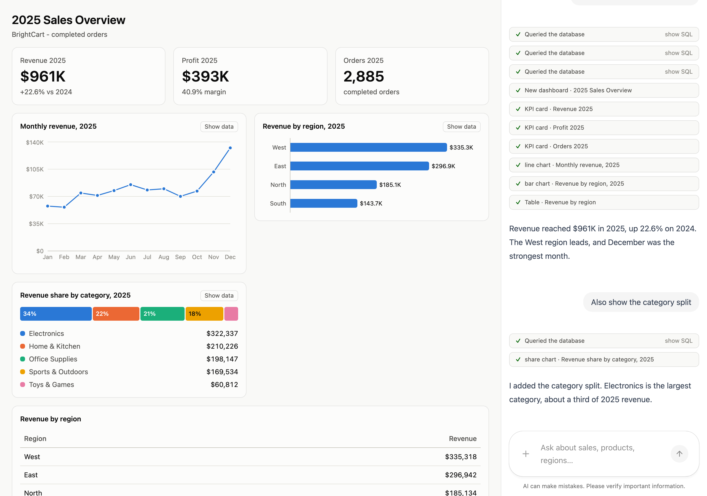
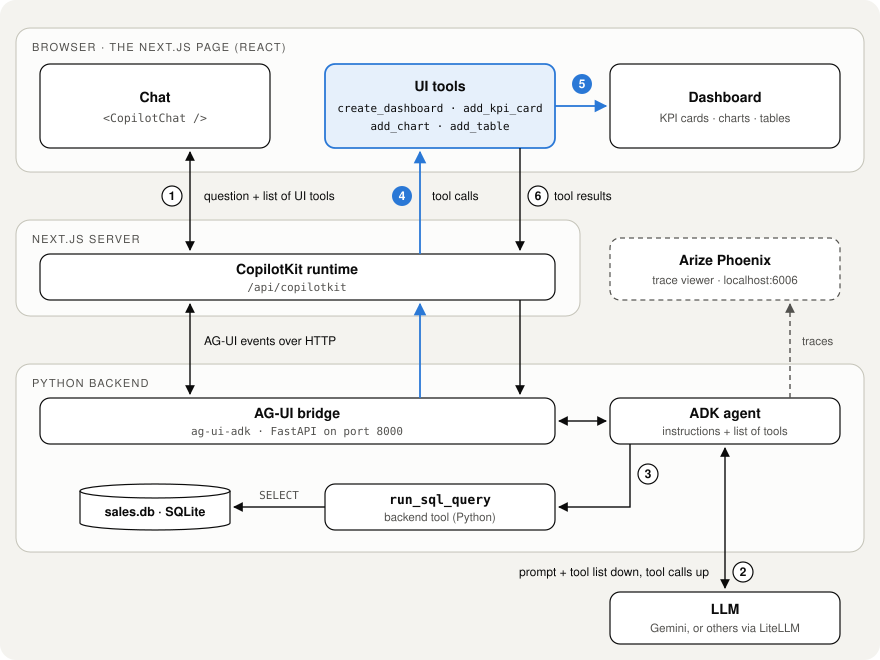

# AI402Z · Agentic UI

Special Topics: Agentic UI. A step-by-step tutorial that builds a small reporting chatbot. You ask a business question in a chat, and an AI agent reads a database and builds a dashboard on your screen.

## Read the tutorial

### → https://aleimar.github.io/AI402ZAgenticUI/

The tutorial takes you from installation to a running app, then explains every file. If the link does not work yet, open [`docs/index.html`](docs/index.html) in a browser after cloning.



## What you will use

| Piece | Role |
| --- | --- |
| [Google ADK](https://adk.dev/) | The Python framework that runs the agent |
| [CopilotKit](https://docs.copilotkit.ai/google-adk) | The React chat and the hooks that turn components into tools |
| [AG-UI](https://docs.ag-ui.com/) | The protocol between the agent and the web page |
| [LiteLLM](https://docs.litellm.ai/) | Lets the agent use other LLM providers than Gemini |
| [Arize Phoenix](https://arize.com/docs/phoenix) | Shows every LLM call and tool call as a trace |
| SQLite | The sample database (`backend/data/sales.db`) |

## The idea: UI as tools

An LLM acts through tools. Most tools are functions on a server. In this project, four of the tools are React components in the browser: `create_dashboard`, `add_kpi_card`, `add_chart` and `add_table`. When the LLM calls one, the component appears on the page.



1. The page sends your question and its list of UI tools to the agent.
2. The agent gives the LLM the question and all tools. The LLM answers with tool calls.
3. Calls to `run_sql_query` run in Python and read the database.
4. Calls to UI tools travel to the browser as AG-UI events.
5. The browser runs each tool's handler, and the component appears on the dashboard.
6. The browser reports the results, and the agent writes a short summary.

## Quick start

You need Git, [Node.js](https://nodejs.org/) 20.9 or newer, [uv](https://docs.astral.sh/uv/) and a free [Gemini API key](https://aistudio.google.com/apikey). The tutorial explains each step and has Windows commands.

```bash
git clone https://github.com/Aleimar/AI402ZAgenticUI.git
cd AI402ZAgenticUI

# Terminal 1: the agent
cd backend
uv sync                       # installs Google ADK, LiteLLM, Phoenix into backend/.venv
uv run data/seed_database.py
cp .env.example .env          # then put your key in GOOGLE_API_KEY=
uv run main.py

# Terminal 2: the web app
cd frontend
npm install                   # installs CopilotKit, Next.js, React into frontend/node_modules
npm run dev
```

Open http://localhost:3000 and ask: *How did sales perform in 2025?*

### What is not in this repository

The libraries themselves are not uploaded. `uv sync` and `npm install` download them from the lists in `backend/pyproject.toml` and `frontend/package.json`, at the exact versions recorded in the lock files.

| Not uploaded | Created by |
| --- | --- |
| `frontend/node_modules/` (CopilotKit, Next.js, React; about 1 GB) | `npm install` |
| `backend/.venv/` (Google ADK, LiteLLM, Phoenix; about 900 MB) | `uv sync` |
| `backend/.env` (your API key) | you, from `backend/.env.example` |

The `.gitignore` files in the root, `backend/` and `frontend/` keep these out of Git, so `git add .` is safe.

## Repository layout

```
backend/     Python agent: agent.py, tools.py, main.py, tracing.py, data/
             warmup/ holds a tiny stand-alone agent to try in ADK Web first
frontend/    Next.js + CopilotKit web app: app/, hooks/, components/
docs/        The tutorial page (index.html) and the architecture diagram
```

## License

See [LICENSE](LICENSE).
